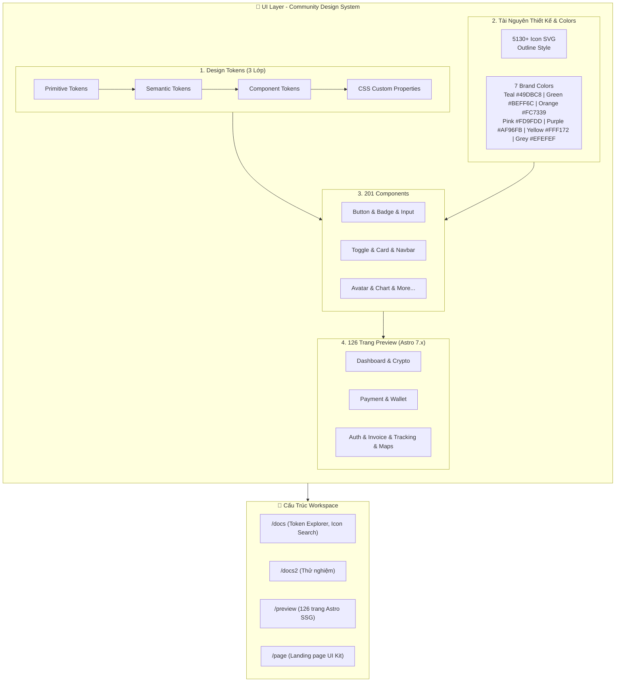

# 🏗️ Sơ Đồ Kiến Trúc Hệ Thống — Community Design System

> **Dự án**: Smart Solar App & Admin Panel — Community UI Kit  
> **Figma Source**: [nlpgroup — Smart Solar App - Admin Panel - UI Kit](https://embed.figma.com/design/eq0EA9dRSWfS2ivuFohJdg/nlpgroup--Smart-Solar-App---Admin-Panel---UI-Kit?embed-host=share)

---

## 📐 Sơ Đồ Kiến Trúc Hệ Thống (Mermaid Diagram)



---

## 🎨 Chi Tiết Các Tầng Thành Phần

### 1. Design Tokens (Hệ Thống 3 Lớp)

Hệ thống Design Token được tổ chức theo tiêu chuẩn phân tầng rõ ràng nhằm bảo đảm tính nhất quán và khả năng chuyển đổi theme:

| Lớp Token | Mục Đích | Ví Dụ |
| :--- | :--- | :--- |
| **Primitive Tokens** | Định nghĩa giá trị thô cơ sở (màu sắc, kích thước, khoảng cách) | `color-teal-500: #49DBC8`, `space-4: 16px` |
| **Semantic Tokens** | Gắn ngữ cảnh sử dụng cho giá trị nguyên bản | `color-primary: var(--color-teal-500)`, `color-success: var(--color-green-500)` |
| **Component Tokens** | Áp dụng trực tiếp vào cấu hình giao diện của từng component | `button-bg-primary: var(--color-primary)`, `card-border-radius: var(--radius-lg)` |
| **CSS Custom Properties** | Xuất ra biến CSS biến đổi được theo dark/light mode | `:root { --sys-color-primary: #49DBC8; }` |

---

### 2. Style Assets & Bảng Màu Thương Hiệu (Brand Colors)

Bộ màu nhận diện thương hiệu gồm 7 màu chủ đạo được chuẩn hóa:

| Tên Màu | Mã HEX | Vai Trò Thiết Kế |
| :--- | :--- | :--- |
| **Teal** | `#49DBC8` | Màu thương hiệu chính (Primary / Accent / Energy) |
| **Green** | `#BEFF6C` | Trạng thái tích cực, điện năng xanh, sản lượng mặt trời (Success / Solar Eco) |
| **Orange** | `#FC7339` | Cảnh báo nhiệt, tải trọng cao, ánh xạ mặt trời (Warning / Radiation / Heat) |
| **Pink** | `#FD9FDD` | Điểm nhấn giao diện phụ, phân loại tài sản (Accent Pink) |
| **Purple** | `#AF96FB` | Phân tích biểu đồ, thống kê chỉ số năng lượng (Data Analytics) |
| **Yellow** | `#FFF172` | Chỉ số bức xạ UV, trạng thái chờ (Caution / Sun Intensity) |
| **Grey** | `#EFEFEF` | Màu nền phụ, đường viền, thẻ card trung tính (Surface & Neutral Light) |

* **Iconography**: Thư viện chứa **5130+ SVG Icons** chuẩn phong cách Outline đồng nhất, hỗ trợ tìm kiếm động trong trang `/docs`.

---

### 3. UI Components (201 Components)

Kho linh kiện giao diện hoàn chỉnh đáp ứng các tác vụ từ cơ bản đến phức tạp:
* **Form & Controls**: Button, Input, Toggle, Checkbox, Select, DatePicker, Range Slider.
* **Layout & Navigation**: Navbar, Sidebar, Breadcrumb, Tabs, Pagination.
* **Data Display**: Card, Badge, Avatar, Table, Tooltip, Modal, Drawer.
* **Smart Solar & Admin Charts**: Chart widgets, biểu đồ tiêu thụ điện mặt trời, bản đồ nhiệt năng lượng, camera giám sát trạm sạc.

---

### 4. 126 Trang Mẫu Xem Trước (Astro 7.x SSG)

Tập hợp 126 màn hình thực tế phục vụ Smart Solar App & Admin Panel:
* **Dashboard & Monitoring**: Giám sát hiệu suất pin, công suất tấm thu, lưu lượng hòa lưới.
* **Crypto & Solar Energy Trading**: Mua bán tín chỉ carbon, thanh toán token năng lượng xanh.
* **Payment & Wallet**: Ví thanh toán, hóa đơn tiền điện, lịch sử giao dịch.
* **Auth, Invoice & Tracking**: Xác thực 2 bước, quản lý hóa đơn PDF, theo dõi kỹ thuật viên lắp đặt trên bản đồ số (Maps).

---

## 🛠️ Chi Tiết Triển Khai Trong Workspace

### 1. Cấu Trúc Thư Mục

```text
solar/
├── docs/             # Token Explorer, Icon Search & Component Showcase
├── docs2/            # Không gian thử nghiệm các tính năng & component mới
├── preview/          # 126 trang xem trước dựng bằng Astro 7.x (SSG)
├── page/             # Landing page giới thiệu bộ Community UI Kit
├── ARCHITECTURE.md   # Tài liệu sơ đồ kiến trúc hệ thống
└── README.md         # Hướng dẫn tổng quan dự án
```

* **`/docs`**: Tài liệu tra cứu Design Tokens, tìm kiếm Icon và xem trước Component.
* **`/docs2`**: Thử nghiệm và nguyên mẫu giao diện nhanh.
* **`/preview`**: Chạy môi trường xem trước với 126 trang dựng sẵn trên **Astro 7.x (SSG)**.
* **`/page`**: Trang giới thiệu / Landing page cho bộ Community UI Kit.

---

### 2. Các Bước Khởi Động Nhanh

#### Xem Trước Trang Sản Phẩm (`/preview`)

```bash
cd preview
pnpm install
pnpm dev # Mở tại http://localhost:4321
```

#### Chạy Trang Tài Liệu (`/docs`)

```bash
cd docs
npm install
npm run dev # Mở tại http://localhost:3000 hoặc mở trực tiếp file docs/index.html
```

