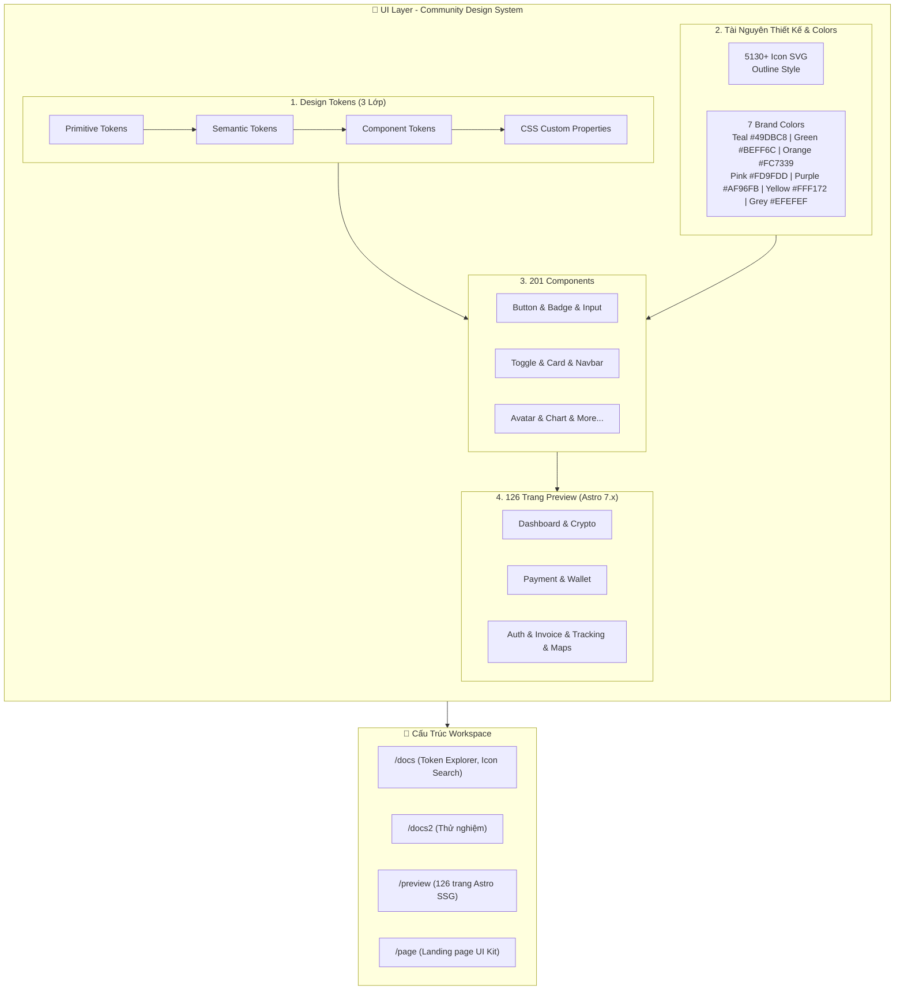

# ☀️ Smart Solar App & Admin Panel — Community Design System

> Hệ thống thiết kế cốt lõi (Community Design System) và bộ UI Kit cho ứng dụng Năng lượng Mặt trời Thông minh & Bảng Điều khiển Quản trị (Admin Panel).


---

## 📌 Sơ Đồ Kiến Trúc Hệ Thống

Xem tài liệu chi tiết đầy đủ tại: [ARCHITECTURE.md](file:///d:/solar/ARCHITECTURE.md)



---

## ⚡ Bắt Đầu Nhanh

### 1. Môi Trường Xem Trước 126 Màn Hình (`/preview`)

```bash
cd preview
pnpm install
pnpm dev
# Truy cập tại: http://localhost:4321
```

### 2. Trang Tra Cứu Token & Icon Thư Viện (`/docs`)

```bash
cd docs
npm install
npm run dev
# Truy cập tại: http://localhost:3000
```

---

## 🎨 Bản Vẽ Thiết Kế Figma

- **Figma File**: [nlpgroup — Smart Solar App - Admin Panel - UI Kit](https://embed.figma.com/design/eq0EA9dRSWfS2ivuFohJdg/nlpgroup--Smart-Solar-App---Admin-Panel---UI-Kit?embed-host=share)
